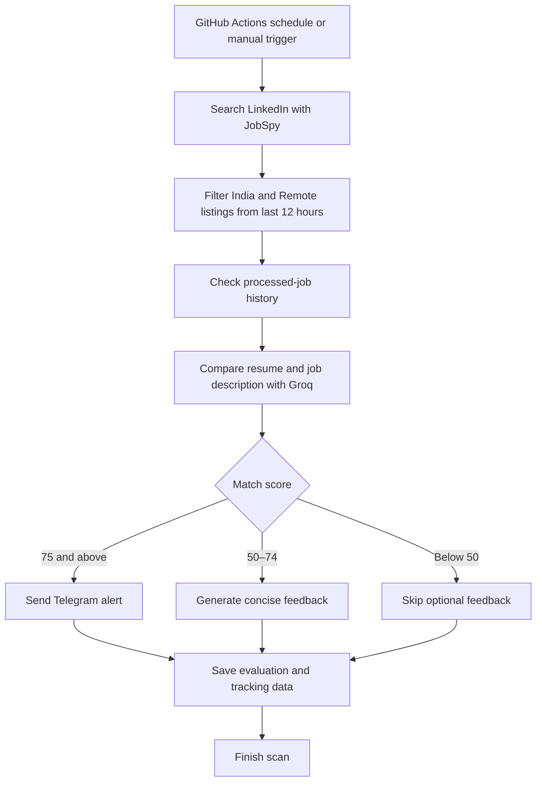

# LinkedIn Job Search Agent 🤖

<p align="left">
  <a href="https://github.com/CloudFlamedev/linkedin-agent/actions/workflows/linkedin-agent.yml"></a>
  
  
  
  
</p>

An AI-assisted job discovery and screening tool built with **Python, LangGraph, Groq, and PostgreSQL**. It searches LinkedIn job listings for **India-based and remote opportunities**, compares job descriptions with a resume, scores potential matches, and sends qualifying opportunities to Telegram.

> **Project goal:** Reduce manual job-search effort by automating discovery, initial resume-to-role screening, duplicate tracking, and job alerts. The agent assists with finding and evaluating jobs; it does **not** automatically submit applications.

---

## ✨ Highlights

- **Focused search:** Searches India-based openings and remote opportunities.
- **Fresh listings:** Targets jobs posted within the previous **12 hours**.
- **AI-assisted matching:** Uses an LLM to compare job descriptions with the candidate resume and produce a match score, relevant skills, missing skills, and a short assessment.
- **Experience screening:** Flags roles that exceed the configured experience range.
- **Telegram alerts:** Sends alerts for newly evaluated jobs that meet the configured **75+ match-score threshold**.
- **Token-aware workflow:** Skips unnecessary feedback for low-scoring roles and keeps cover-letter generation disabled to conserve LLM usage.
- **Model fallback:** Rotates through configured Groq models when a model is rate-limited or returns an empty response.
- **Persistent job tracking:** Uses Neon PostgreSQL to preserve processed-job history across temporary GitHub-hosted runners and reduce duplicate processing.
- **Scheduled automation:** Runs through GitHub Actions on an intended four-hour cadence, with a manual workflow trigger for testing.
- **Local development support:** Can use the local database configuration described by the project’s database adapter and `.env.example`.

## 🧭 How it works



### Match handling

| Match score | Agent behaviour |
|---|---|
| **75–100** | Eligible for a Telegram job alert, subject to experience checks and duplicate detection |
| **50–74** | Generates concise skills-gap feedback when the evaluation succeeds |
| **Below 50** | Skips optional feedback to conserve tokens |

Jobs outside the configured experience range are logged and excluded from alerts. A job that has already been processed is skipped to help avoid duplicate notifications.

## 🧰 Tech stack

| Area | Technology | Role |
|---|---|---|
| Language | Python 3.12 | Core application and workflow logic |
| Agent workflow | LangGraph / LangChain | Organises the agent’s evaluation flow |
| LLM inference | Groq API | Resume-to-job matching and optional feedback |
| Job discovery | JobSpy | Retrieves LinkedIn job listings |
| Persistent storage | Neon PostgreSQL | Stores job-tracking and evaluation data for scheduled runs |
| Local storage | SQLite, where configured | Supports local development and migration workflows |
| Notifications | Telegram Bot API | Sends qualifying job alerts |
| Automation | GitHub Actions | Schedules and runs the agent without requiring a personal computer to remain on |

## 🗂️ Project structure

```text
linkedin-agent/
├── .github/
│   └── workflows/
│       └── linkedin-agent.yml  # Scheduled and manual GitHub Actions workflow
├── data/
│   └── resume.pdf              # Local resume file; keep private
├── nodes/
│   ├── evaluator.py            # Resume/job evaluation
│   ├── feedback.py             # Skills-gap feedback
│   └── logger.py               # Evaluation logging
├── scripts/
│   └── schedule_guard.py       # Scheduled-run eligibility checks
├── tools/
│   ├── database.py             # Database adapter
│   ├── job_tracker.py          # Processed-job tracking
│   ├── llm_client.py           # Groq model routing and fallback
│   ├── resume_parser.py        # Resume parsing helpers
│   └── telegram_notifier.py   # Telegram notifications
├── graph.py                    # LangGraph workflow
├── state.py                    # Agent state definition
├── main.py                     # Application entry point
├── migrate_sqlite_to_neon.py   # Optional local-history migration
├── requirements.txt            # Python dependencies
└── .env.example                # Environment-variable template
```

> The exact contents can evolve as the project changes. Keep secrets, local databases, and personal resume data out of public version control.

## 🚀 Run locally

### Prerequisites

- Python 3.12
- A Groq API key
- A Telegram bot token and chat ID
- A Neon PostgreSQL connection string for persistent online tracking
- A resume PDF

### Setup

1. **Clone the repository.**

   ```bash
   git clone https://github.com/CloudFlamedev/linkedin-agent.git
   cd linkedin-agent
   ```

2. **Create and activate a virtual environment.**

   ```bash
   python3.12 -m venv venv
   source venv/bin/activate
   ```

3. **Install dependencies.**

   ```bash
   python -m pip install --upgrade pip
   pip install -r requirements.txt
   ```

4. **Configure environment variables.**

   ```bash
   cp .env.example .env
   ```

   Edit `.env` and provide the required credentials. Common settings include:

   ```dotenv
   GROQ_API_KEY=your_groq_api_key
   TELEGRAM_BOT_TOKEN=your_telegram_bot_token
   TELEGRAM_CHAT_ID=your_telegram_chat_id
   DATABASE_URL=your_neon_postgresql_connection_string
   ```

   Use the complete connection string copied from Neon, including its SSL parameters. Check `.env.example` for any additional project-specific settings. **Never commit `.env` or share credentials.**

5. **Add your resume.**

   Place your resume at `data/resume.pdf`. Do not commit personal resume information to a public repository.

6. **Run a one-time scan.**

   ```bash
   python main.py --once --skip-schedule-check
   ```

   To use the application’s normal local entry point and scheduler, run:

   ```bash
   python main.py
   ```

## ☁️ GitHub Actions deployment

The workflow is located at `.github/workflows/linkedin-agent.yml`. It supports scheduled execution and manual runs from the **Actions** tab.

### Required repository secrets

In **Settings → Secrets and variables → Actions**, configure:

| Secret | Description |
|---|---|
| `DATABASE_URL` | Neon PostgreSQL connection string |
| `GROQ_API_KEY` | Groq API key |
| `TELEGRAM_BOT_TOKEN` | Telegram bot token |
| `TELEGRAM_CHAT_ID` | Destination chat ID for alerts |

The workflow also expects `data/resume.pdf` to be available to the runner. Use a private repository and consider whether storing a resume in GitHub is appropriate for your privacy requirements.

### Run manually

1. Open the repository’s **Actions** tab.
2. Select **LinkedIn Job Agent**.
3. Click **Run workflow**.
4. Select the default branch and set `force_run` to `true` if you want to bypass the schedule guard for that manual run.

Scheduled runs can be delayed by GitHub. Check the workflow file in the default branch to confirm the current cron expression and timezone.

## 🔐 Security notes

- Keep `.env`, API keys, bot tokens, and database credentials out of Git.
- Store workflow credentials in GitHub Actions repository secrets.
- Keep the repository private if the resume is stored in the repository.
- Rotate any credentials that were accidentally exposed in a commit.
- Review the job-discovery platform’s terms and applicable usage limits before relying on scraping automation.

## 🛠️ Reliability and token efficiency

- Model fallback helps the agent continue when a configured Groq model is rate-limited or returns an empty response.
- The agent tracks processed jobs in persistent storage to reduce duplicate evaluation and notifications.
- Optional feedback is skipped for lower-scoring listings, and cover-letter generation is disabled in the current workflow to conserve tokens.
- A successful GitHub Actions run does not guarantee a Telegram message: alerts depend on finding a new job that passes the configured score, experience, and duplicate checks.

## 🔮 Possible future improvements

- Add a dashboard for browsing saved job evaluations.
- Improve duplicate detection by prioritising stable job URLs.
- Add tests and monitoring for scraper failures, model responses, and notification delivery.
- Add configurable job-title, location, and experience preferences.

## 👤 Author

**CloudFlamedev** · [GitHub profile](https://github.com/CloudFlamedev)

---

<p align="center"><i>Built to make targeted job discovery more organised, repeatable, and easier to review.</i></p>
